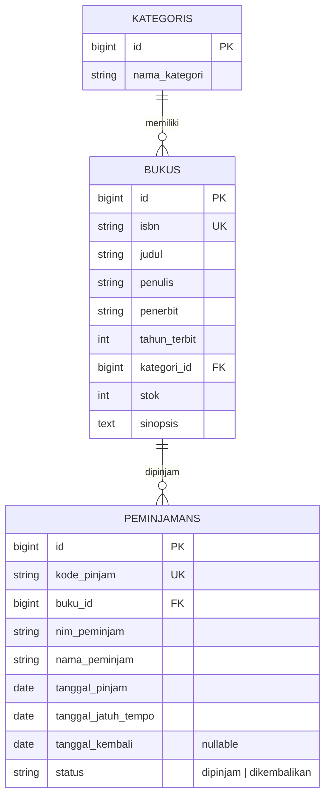
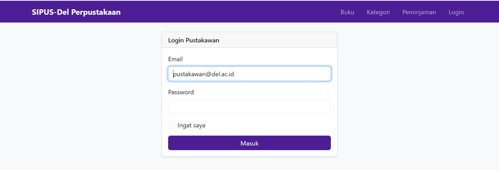
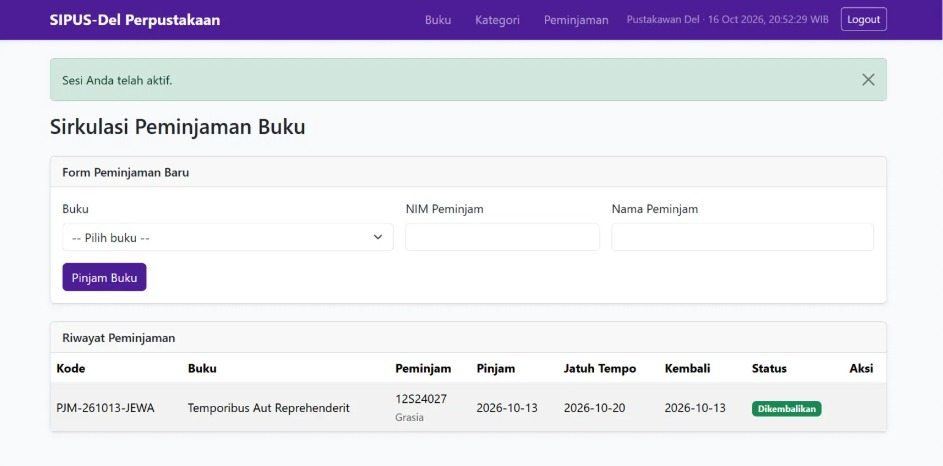
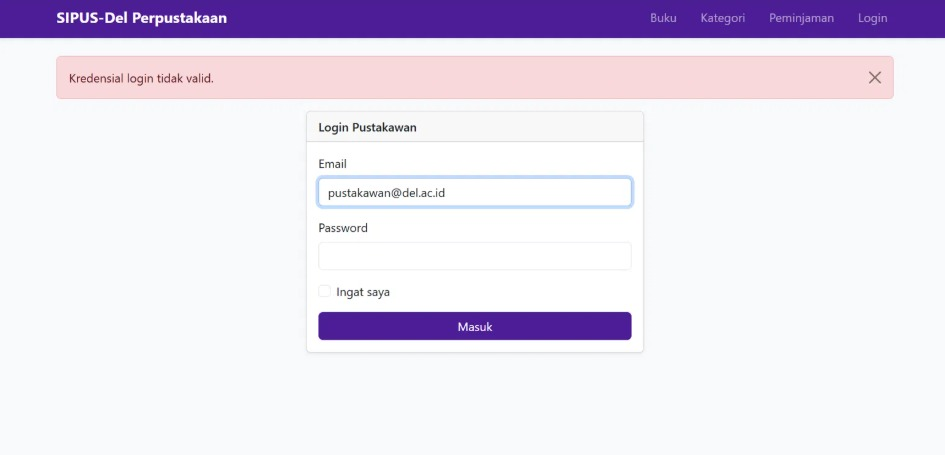
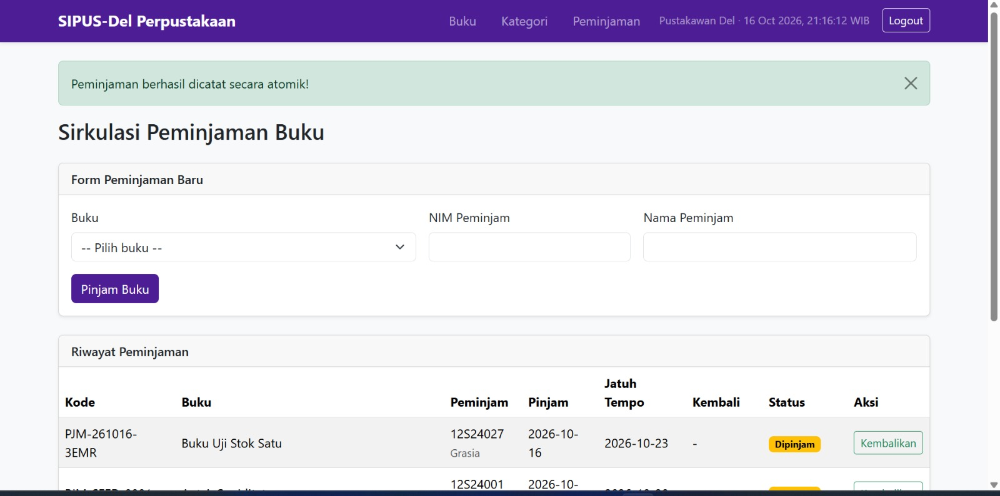
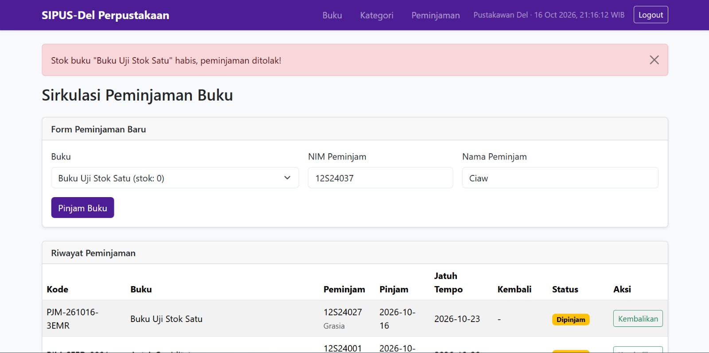
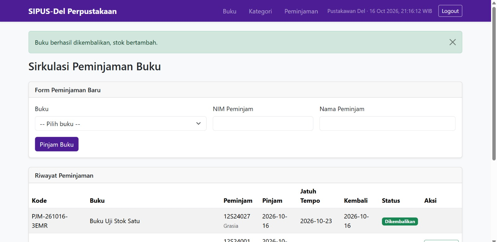
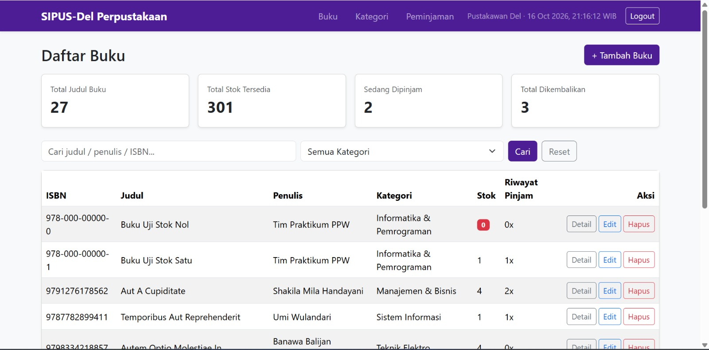
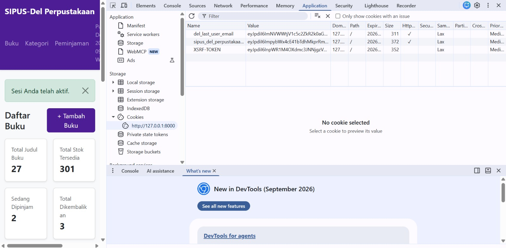

# SIPUS-Del Tahap 2 — Praktikum PPW Minggu 6

Pengembangan lanjutan **Sistem Informasi Perpustakaan Kampus Del (SIPUS-Del)** pada Laravel 11: konektivitas database, transaksi sirkulasi peminjaman dan pengembalian berbasis ACID, rekapitulasi Query Builder, serta manajemen sesi dan autentikasi pustakawan.

| | |
|---|---|
| **Nama** | Grasia Gayatri Simanullang |
| **NIM** | 12S24027 |
| **Mata Kuliah** | Pemrograman dan Pengujian Aplikasi Web (12S3101) |
| **Dosen** | Chandro Pardede, S.Kom., M.Sc. |
| **Repositori** | https://github.com/Grasiasimanullang/ppw-2026-week6-12S24027 |
| **Branch** | `week6-db-session` |

## Teknologi
Laravel 11, PHP 8.2+, SQLite, Blade, Bootstrap 5.3 (CDN), Eloquent ORM, Query Builder.

## Akun Uji Pustakawan
| Email | Password |
|---|---|
| `pustakawan@del.ac.id` | `password123` |

## Cara Menjalankan
```bash
composer install
copy .env.example .env        # Windows (Linux/macOS: cp .env.example .env)
php artisan key:generate
php artisan migrate --seed
php artisan serve
```
Buka `http://127.0.0.1:8000`. Pastikan ekstensi `pdo_sqlite` dan `sqlite3` aktif, dan file `database/database.sqlite` sudah ada.

## ERD

Relasi `peminjamans.buku_id` memakai `cascadeOnDelete` (menghapus buku ikut menghapus riwayat peminjamannya).

## Fitur dan Implementasi

### 1. Skema `peminjamans` dan relasi Eloquent
Migration `create_peminjamans_table` dengan foreign key `buku_id` ke `bukus`. Model `Peminjaman` (`$fillable`, `belongsTo(Buku::class)`) dan `Buku::peminjamans()` (`hasMany`). Nama tabel ditentukan eksplisit (`protected $table = 'peminjamans'`) karena pluralisasi otomatis Laravel menebak `peminjamen`.

### 2. Transaksi ACID dan Concurrency Locking
Peminjaman dan pengembalian dibungkus `DB::transaction()` dengan `lockForUpdate()`:
- **Pinjam:** kunci baris buku, tolak jika `stok < 1`, tolak jika NIM yang sama masih meminjam buku yang sama, lalu `decrement('stok')` dan catat ke `peminjamans`.
- **Kembali:** kunci baris peminjaman dan buku, ubah status jadi `dikembalikan`, isi `tanggal_kembali`, lalu `increment('stok')`.
- `RuntimeException` (aturan bisnis) ditampilkan sebagai pesan error; `QueryException` dicatat lewat `Log::error()`.

> Catatan: `lockForUpdate()` benar-benar mengunci baris pada MySQL/InnoDB. Pada SQLite perintah ini diabaikan karena SQLite mengunci seluruh database saat menulis. Kodenya tetap sesuai spesifikasi dan siap dipakai di MySQL.

### 3. Query Builder, `withCount`, dan filter dinamis
Katalog buku memakai `Buku::with('kategori')->withCount('peminjamans')` (bebas N+1), filter `when()` untuk judul/penulis/ISBN dan kategori, serta `paginate(10)->withQueryString()`. Kartu statistik memakai `DB::table()`: total judul, total stok tersedia (`sum('stok')`), total sedang dipinjam, dan total dikembalikan.

### 4. Session, Cookie, dan Autentikasi
- `AuthController`: `Auth::attempt()`, `session()->regenerate()` saat login (anti Session Fixation), `invalidate()` + `regenerateToken()` saat logout.
- Rute mutasi (CRUD buku/kategori, peminjaman, pengembalian) diproteksi middleware `auth`; katalog buku/kategori tetap publik (read-only).
- State Session: `last_search` (pencarian terakhir) dan `login_timestamp`.
- Cookie: `del_last_user_email` lewat `Cookie::queue()` (7 hari) untuk mengisi otomatis email di halaman login.

### 5. Seeder
`PustakawanSeeder` (akun uji), `PeminjamanSeeder` (buku uji stok 0 dan stok 1, serta tiga sampel transaksi), dipanggil dari `DatabaseSeeder`.

## Bukti Pengujian

### Login dan Session
| Halaman login | Login berhasil | Login gagal |
|---|---|---|
|  |  |  |

### Transaksi Peminjaman dan Pengembalian
**Peminjaman berhasil** (stok berkurang secara atomik):


**Penolakan saat stok = 0** (transaksi di-rollback, stok tidak menjadi minus):


**Pengembalian buku** (status berubah, stok bertambah):


### Query Builder dan Statistik


### Audit Cookie pada Browser DevTools
Cookie sesi Laravel dan cookie `del_last_user_email` memiliki flag **HttpOnly** (tidak bisa dibaca JavaScript, mitigasi pencurian cookie lewat XSS) dan `SameSite=Lax` (mitigasi CSRF).


## Riwayat Commit (Conventional Commits)
- `feat(migration): create peminjamans table with foreign key to bukus`
- `feat(transaction): implement ACID book borrowing and return with lockForUpdate`
- `feat(query-builder): add library analytics dashboard and dynamic search`
- `feat(auth-session): implement librarian login, session regeneration, and cookies`
- `feat(seeder): add librarian, zero/one stock books, and sample borrowing transactions`

## Keamanan
Berkas `.env` dan folder `vendor/` tidak di-commit (lihat `.gitignore`). Gunakan `.env.example` sebagai acuan konfigurasi.