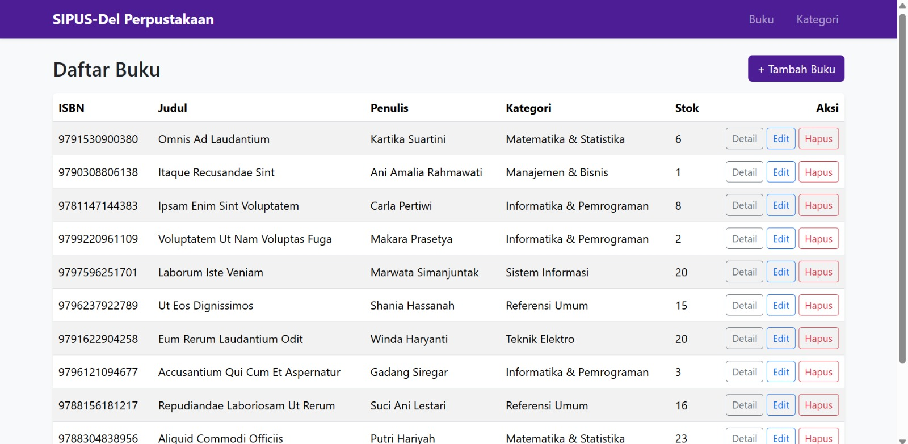
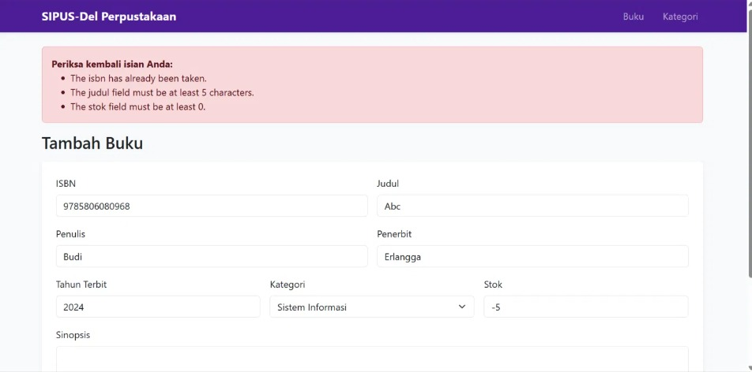
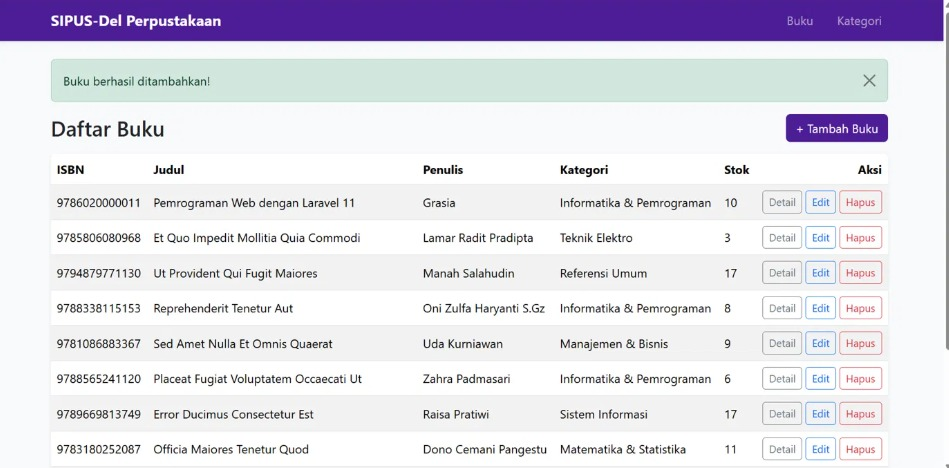
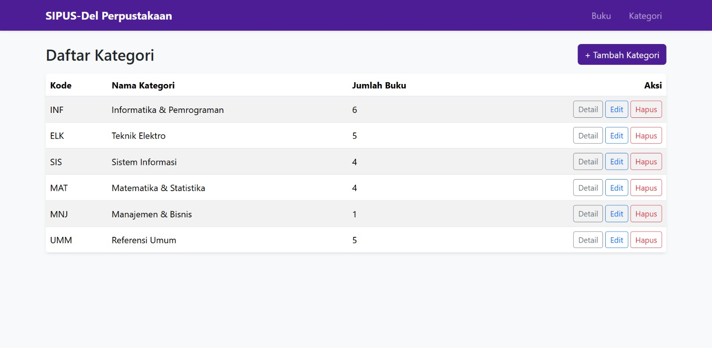
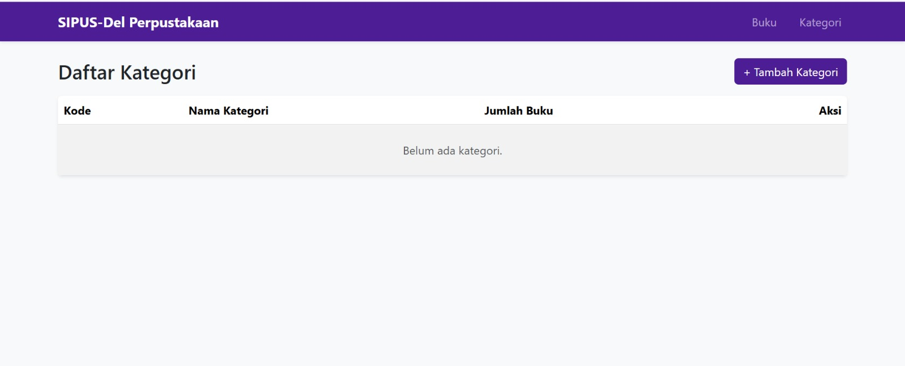

# SIPUS-Del: Sistem Informasi Perpustakaan Kampus Del

Praktikum Minggu 5, Pemrograman & Pengujian Web (12S3101), Institut Teknologi Del.
Aplikasi CRUD perpustakaan berbasis **Laravel 11** dengan pola **MVC**, Eloquent ORM, validasi server-side, dan Blade Component.

- **NIM:** 12S24027
- **GitHub:** [Grasiasimanullang](https://github.com/Grasiasimanullang)
- **Tema UI:** Del Royal Purple (`#4C1D95`)

## Fitur

- CRUD **Kategori** dan **Buku** (7 aksi RESTful via `Route::resource`)
- Relasi Eloquent One-to-Many: `Kategori hasMany Buku`, `Buku belongsTo Kategori`
- Implicit Route Model Binding
- Eager Loading (`Buku::with('kategori')`) untuk mencegah N+1 Query Problem
- Validasi server-side (`$request->validate()`), proteksi CSRF (`@csrf`) dan method spoofing (`@method`)
- Master layout `<x-layout>`, pagination Bootstrap 5, flash message, dan `@forelse` untuk data kosong
- Seeder dan Factory (Faker) untuk 6 kategori dan 25 buku
- Audit kueri SQL melalui `DB::listen`

## Prasyarat

- PHP 8.2 atau lebih baru (ekstensi `pdo_sqlite`, `sqlite3`, `mbstring`, `openssl`, `fileinfo`, `curl`)
- Composer 2.6 atau lebih baru
- Git

## Instalasi

```bash
git clone https://github.com/Grasiasimanullang/ppw-2026-week5-12S24027.git
cd ppw-2026-week5-12S24027
composer install
cp .env.example .env
php artisan key:generate
touch database/database.sqlite      # Windows PowerShell: New-Item database\database.sqlite -ItemType File
php artisan migrate:fresh --seed
php artisan serve
```

Buka `http://127.0.0.1:8000`.

> Jika `composer install` menolak paket karena security advisory Laravel 11, jalankan
> `composer config policy.advisories.block false` lalu ulangi `composer install`.
> Pengaturan ini hanya untuk keperluan praktikum lokal.

## Struktur MVC

| Lapisan | Lokasi | Isi |
|---|---|---|
| Model | `app/Models` | `Kategori.php`, `Buku.php` (relasi dan `$fillable`) |
| View | `resources/views` | `components/layout.blade.php`, `buku/*`, `kategori/*` |
| Controller | `app/Http/Controllers` | `BukuController.php`, `KategoriController.php` |
| Routing | `routes/web.php` | `Route::resource('buku')`, `Route::resource('kategori')` |

## Skema Database (ERD)

```
kategoris                      bukus
-------------                  ------------------------------
id (PK)                        id (PK)
kode_kategori (unique)         isbn (unique)
nama_kategori                  judul (index)
timestamps                     penulis
     1 ───────────< N          penerbit
                               tahun_terbit
                               kategori_id (FK -> kategoris.id, cascade on delete)
                               stok
                               sinopsis (nullable)
                               timestamps
```

## Validasi

| Field | Aturan |
|---|---|
| ISBN | wajib, maksimal 17 karakter, unik |
| Judul | wajib, minimal 5 karakter |
| Tahun terbit | wajib, integer, 1900 sampai tahun berjalan |
| Kategori | wajib, harus ada di tabel `kategoris` |
| Stok | wajib, integer, minimal 0 |

## Bukti Audit SQL (Eager Loading)

`AppServiceProvider::boot()` mencatat setiap kueri ke `storage/logs/laravel.log` dengan awalan `[SQL AUDIT]`.
Hasil untuk halaman `/buku` (10 buku per halaman) disimpan di folder `docs/`:

| Kondisi | Berkas | Kueri data |
|---|---|---|
| Lazy loading (N+1) | `docs/sql-audit-sebelum.log` | 1 count + 1 bukus + **10** kategoris = 12 |
| Eager loading | `docs/sql-audit-sesudah.log` | 1 count + 1 bukus + **1** kategoris = 3 |

Dengan `with('kategori')`, seluruh kategori diambil dalam satu kueri `where id in (...)`, sehingga jumlah kueri konstan berapa pun jumlah barisnya.
Modul menyebut 2 kueri; satu kueri `count` tambahan berasal dari `paginate()`.

## Screenshot

| Halaman | Gambar |
|---|---|
| Daftar buku |  |
| Validasi error |  |
| Notifikasi sukses |  |
| Daftar kategori |  |
| Data kosong (`@forelse`) |  |

## Riwayat Commit

Mengikuti konvensi Conventional Commits (`feat`, `perf`, `docs`, `chore`).